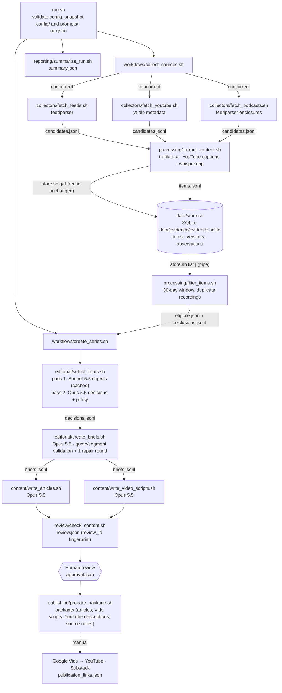

# Problem Set 4 Student Submission

Complete this document with your project details and links. Keep the course instructions in [README.md](README.md) and the required contracts in [ARCHITECTURE.md](ARCHITECTURE.md).

**Student:** Omar Contreras  
**GitHub repository:** [https://github.com/omarcontreras96/ps04-guing-forward](https://github.com/omarcontreras96/ps04-guing-forward)

## Topic and Audience

- **Publication name:** GUIng Forward. The name is a play on "GUI": the series follows how we interact with computers now that AI sits between us and the interface.
- **Topic:** How AI is changing the way people interact with computers, across three recurring themes:
  1. **Personal context and the devices it drives.** AI needs to know more about you to be helpful
    (memory, connected accounts). That is driving devices such as smart glasses, wearables and
     always-on microphones and cameras, along with a privacy trade-off.
  2. **Computer-use agents.** AI that operates software for you on the desktop, in the browser or across
    apps, including OS-level assistants such as Windows Copilot and the Googlebook's built-in AI.
  3. **Voice and conversational interfaces, or the *2001* question.** Science fiction imagined talking to
    AI like HAL. Is conversation actually the most compelling way to use it?
- **Audience and assumed knowledge:** Tech enthusiasts and early adopters. They use ChatGPT, Claude or Gemini regularly, know what an LLM and an "agent" are, and follow product launches. They do not read HCI research or vendor documentation, and they cannot tell how well these interfaces work outside the demo.
- **Central question:** *Which new ways of interacting with computers through AI are actually changing how people work and live, and which are still demos?*
- **Note:** run 1 used an earlier configuration that did not match this brief. It reworded the question and added a fourth theme. The correction is documented in [review_notes/option_b_changes.md](review_notes/option_b_changes.md).
- **Scope and exclusions:**
  - **Included:** launches that change how people operate computers, hands-on reviews and practitioner experience, HCI research with user evidence, and reliability, safety and privacy evidence about these interfaces.
  - **Excluded:** benchmark races, funding and stock news, chips and data centres, policy not tied to an interface, and unsourced rumours.
- **Reason for readers to return:** Each edition re-scores the same question against the last 30 days: what shipped, what held up in real use, and what to watch next. Readers can use it to decide which interfaces are worth adopting.


## Published Series


| Piece | Title                                                                            | Substack article                                                                                                                                           | YouTube video                                                |
| ----- | -------------------------------------------------------------------------------- | ---------------------------------------------------------------------------------------------------------------------------------------------------------- | ------------------------------------------------------------ |
| 1     | The agent became the front door; the hardware is still auditioning               | [https://guingforward.substack.com/p/the-agent-became-the-front-door-the](https://guingforward.substack.com/p/the-agent-became-the-front-door-the)         | [https://youtu.be/6WbYMjLE_EA](https://youtu.be/6WbYMjLE_EA) |
| 2     | A confirmation step is not verification                                          | [https://guingforward.substack.com/p/a-confirmation-step-is-not-verification](https://guingforward.substack.com/p/a-confirmation-step-is-not-verification) | [https://youtu.be/lDymNL8g0Xc](https://youtu.be/lDymNL8g0Xc) |
| 3     | Talk to delegate, look to check: what the '2001' question looks like in practice | [https://guingforward.substack.com/p/talk-to-delegate-look-to-check](https://guingforward.substack.com/p/talk-to-delegate-look-to-check)                   | [https://youtu.be/SKc7C__BY10](https://youtu.be/SKc7C__BY10) |


**Where the series came from:** all three articles and videos come from run `live-20261015T045321Z`,
with as-of date 2026-10-15. Each article and its video script were generated from the same brief and
the same evidence passages. Both passed `check_content.sh`, were approved by me (`approval.json`), and
were packaged.

- **Articles:** published from `runs/live-20261015T045321Z/package/articles/`.
- **Videos:** produced in Google Vids ("docs to video", AI voiceover, no avatar) from
`package/video_scripts/`.
- **YouTube descriptions:** from `package/youtube/`. Each contains the article link, the as-of date,
timestamped sources and an AI disclosure.
- **Links:** recorded in `package/publication_links.json`. The articles are free on Substack; the
videos are unlisted.

**Separate technical demonstration video:** TODO

## Setup and Execution

**Tools used (versions as tested):**

- macOS on Apple Silicon
- Bash 3.2+
- `jq` 1.7
- Python 3.13 with the packages pinned in `requirements.txt`: `anthropic`, `feedparser`, `trafilatura`
- `yt-dlp`
- `ffmpeg`
- `whisper.cpp` (`whisper-cli`) with the `ggml-base.en` model

Install:

```bash
brew install jq yt-dlp ffmpeg whisper-cpp
uv venv .venv.nosync --python 3.13 && uv pip install --python .venv.nosync/bin/python -r requirements.txt
mkdir -p ~/.cache/whisper-cpp && curl -L -o ~/.cache/whisper-cpp/ggml-base.en.bin https://huggingface.co/ggerganov/whisper.cpp/resolve/main/ggml-base.en.bin
cp .env.example .env   # then set ANTHROPIC_API_KEY
```

The `.nosync` suffix keeps the virtualenv out of iCloud sync. `lib/common.sh` looks for an interpreter in this order: `PIPELINE_PYTHON`, then `.venv.nosync`, then `.venv`, then `python3`.

**Credentials and environment variables:** credentials are never written to config snapshots or logs.

- `ANTHROPIC_API_KEY` (required). Read from the environment or from the untracked `.env` file.
- `WHISPER_MODEL` (optional). Path to a whisper.cpp model file.
- `PIPELINE_SIMULATE_FAILURE` (optional). Comma-separated `source_id`s to fail deliberately; every such failure is labelled as simulated.

**Models:** set in `config/project.json` under `pipeline.models`.

- Item digests: `claude-sonnet-5-5`, one call per eligible item, cached per item version.
- Editorial decisions, briefs, articles and video scripts: `claude-opus-5-5`.
- Prices are in `pipeline.pricing_usd_per_mtok`. Every receipt records token usage and the computed cost.

**Configuration:**

- `config/project.json`: topic, audience, central question, voice, themes and pipeline settings.
- `config/sources.json`: 17 sources from 17 independent publishers (11 RSS, 3 YouTube channels, 3 podcasts).
  - **Perspectives covered:**
    - research: arXiv cs.HC
    - vendors: Google, Microsoft, Meta
    - journalism: Ars Technica, UploadVR, Road to VR, 9to5Google, MKBHD, the Vergecast, Big Technology
    - practitioners: Nielsen Norman Group, Simon Willison, Claire Vo, Sam Witteveen
    - commentary: Ethan Mollick, Nate B Jones
  - **Independence judgments:**
    - Each producer has a single `publisher_id`. The Verge is used only through the Vergecast, not its
    site or YouTube channel, because the latter re-uploads the podcast.
    - No configured YouTube channel re-uploads a configured podcast. `filter_items.sh` also reconciles
    any same-publisher YouTube and podcast copies of one recording.
    - Meta appears both as a vendor (Meta Newsroom) and through Muse's design director on *How I AI*.
    These are separate publishers, but both are treated as vendor-interested statements under
    policy §4.
    - Several outlets repeating one announcement count as one claim (policy §3). Each has `source_id`, `publisher_id`, `kind` and `url`. Optional fields are `name`, `perspective`, `max_items`, `include_keywords` and `min_seconds`.
- `config/editorial_policy.md`: the editorial policy.
- `prompts/*.md`: one prompt file per AI stage.

**Commands:**

```bash
bash run.sh                                   # new live run -> runs/live-YYYYMMDDTHHMMSSZ/, stops at awaiting_review
bash review/record_approval.sh runs/RUN_ID approve "Name" "notes"   # human decision, after reading the drafts
bash run.sh --package runs/RUN_ID             # recheck, verify approval, build runs/RUN_ID/package/
bash run.sh --resume runs/RUN_ID              # continue an interrupted run (no recollection; finished stages kept)
bash run.sh --mode replay --reuse-evidence runs/RUN_ID --note "..."   # rerun editorial stages on identical evidence
bash tests/fixture_checks.sh                  # deterministic checks from examples/README.md (disposable store)
bash reporting/trace_claim.sh runs/RUN_ID 03-c4   # trace a published claim to its source passage
```

Every component can be run on its own, for example to replay a single stage:

```bash
R=runs/RUN_ID
bash collectors/fetch_feeds.sh $R > /tmp/feeds.jsonl
bash processing/extract_content.sh $R < $R/candidates.jsonl > /tmp/items.jsonl
bash data/store.sh list | bash processing/filter_items.sh $R > /tmp/eligible.jsonl
bash data/store.sh get ITEM_ID [VERSION_ID]; bash data/store.sh history ITEM_ID
bash editorial/select_items.sh $R < $R/eligible.jsonl > /tmp/decisions.jsonl
bash editorial/create_briefs.sh $R < $R/decisions.jsonl > /tmp/briefs.jsonl
bash content/write_articles.sh $R < $R/briefs.jsonl > /tmp/articles.jsonl
bash review/check_content.sh $R > /tmp/review.json
bash reporting/summarize_run.sh $R
```


## Architecture and Manual Handoffs




**Where models are called:** only in `editorial/select_items.sh` (both passes), `editorial/create_briefs.sh`, and the two `content/` scripts. They all go through `lib/llm.py`. That file saves the exact request and response under `runs/RUN_ID/llm/<stage>/` and adds token usage and cost to the stage receipt.

**Where evidence is stored:**

- **Evidence index:** `data/evidence/evidence.sqlite`. Only `data/store.sh` opens it, through its helper `data/store_db.py`.
- **Retained text and transcript segments:** `data/assets/text/` and `data/assets/segments/`. Files are content-addressed, so they are never overwritten.
- **Original downloads:** `data/media/`. Podcast and fallback audio are excluded from Git.
- **Item digests:** cached in `data/assets/digests/`.

**Helpers added (each stays inside its owning component's responsibility):**

- `lib/common.sh`: env and interpreter setup, `RUN_DIR` validation, receipts.
- `lib/receipt.py`: writes receipts and computes cost.
- `lib/llm.py`: model provider wrapper.
- `lib/util.py`: hashing, IDs, dates, HTTP.
- `lib/evidence.py`: resolves evidence references through `store.sh get` and renders items for the model.
- Language-specific workers sit next to their components:
  - `collectors/*.py`
  - `processing/extract.py` and `filter.py`
  - `editorial/select.py` and `briefs.py`
  - `content/draft.py`, shared by the article and script components so both use the same evidence passages
  - `review/check.py`
  - `publishing/package.py`
  - `reporting/summarize.py`
- `review/record_approval.sh`: a convenience for the human reviewer only.

**Identity and versioning:**

- `item_id`**:**
  - `feed:<publisher>:<sha256(canonical URL)[:12]>`
  - `youtube:<video id>`
  - `podcast:<publisher>:<sha256(GUID)[:12]>`
- `version_id`**:** sha256 of compact, sorted JSON of `{title, url, published_at, text, segments}`. Retrieval time is excluded. This matches the fixture computation in `examples/`, and the fixture version IDs reproduce exactly.
- **Repeated observations:** the store logs them in `observations`. They never create a version.

**Manual handoffs:**

1. **Human editorial review.** Inputs: `runs/RUN_ID/articles/`, `video_scripts/`, `briefs.jsonl`, `review.json`, `decisions.jsonl`, and the evidence passages. The reviewer records corrections in `runs/RUN_ID/corrections.md` and writes `approval.json` with `review/record_approval.sh`.
2. **Packaging.** `bash run.sh --package runs/RUN_ID` produces `package/`.
3. **Google Vids.** Input: `package/video_scripts/NN.md` (narration without claim markers; on-screen source lines) via "docs to video". Output: a rendered 3–5 minute MP4.
4. **YouTube.** Upload with `package/youtube/NN_description.txt`.
5. **Substack.** Publish `package/articles/NN.md`. Claim markers have become numbered sources, the AI disclosure is appended, and access is free.
6. **Links.** Record the URLs in `package/publication_links.json` and repackage. Links are preserved and placeholders are filled.


## Evidence and Runs

**Evidence locations**

- **Evidence index:** `data/evidence/evidence.sqlite`. It has three tables: items, versions, and
observations (every sighting, with its run). Query it only through `data/store.sh`:
  ```bash
  bash data/store.sh list
  bash data/store.sh get ITEM_ID [VERSION_ID]
  bash data/store.sh history ITEM_ID   # versions plus the runs that observed each one
  ```
- **Retained text and transcripts:** `data/assets/text/` and `data/assets/segments/`, about 30-second
timestamped segments. These are committed and every referenced path resolves.
`data/assets/digests/` holds the cached per-item digests.
- **Original downloads:** `data/media/`. Feed and page HTML and YouTube caption files are committed.
- **Excluded from Git:** podcast audio (`data/media/podcasts/`, about 0.9 GB) and fallback YouTube audio
(`*.m4a`). To retrieve them:
  - **Podcasts:** each item's `media_url` is the original enclosure. Download it with
  `curl -L -o data/media/podcasts/<safe_item_id>.mp3 "<media_url>"`.
  - **YouTube:** `yt-dlp -f bestaudio "<url>"`.
  - Rerunning extraction on an item rebuilds the same transcript, using whisper.cpp `ggml-base.en`.
- **Per-run artifacts:** everything in `runs/RUN_ID/`. That includes the `config/` and `prompts/`
snapshots, every receipt in `logs/`, the exact model requests and responses in `llm/<stage>/`,
`summary.json`, and `logs/run.console.log`.

**Runs** (UTC dates are the as-of dates; Boston local time in parentheses)


| Run                                                                     | Actual date                                  | Run artifacts and logs                                         | Elapsed time                  | Approximate cost |
| ----------------------------------------------------------------------- | -------------------------------------------- | -------------------------------------------------------------- | ----------------------------- | ---------------- |
| **First live run**: baseline, policy v1                                 | 2026-10-15 01:16 UTC (Wed Oct 14, 21:16 EDT) | `[runs/live-20261015T011645Z](runs/live-20261015T011645Z)`     | 19.5 min                      | $4.79            |
| Policy comparison, **replay** (policy v2 on run 1's identical evidence) | 2026-10-15 04:19 UTC                         | `[runs/replay-20261015T041930Z](runs/replay-20261015T041930Z)` | 7.9 min                       | $3.25            |
| Live run with a real collector failure (`fetch_feeds` crashed)          | 2026-10-15 04:36 UTC                         | `[runs/live-20261015T043607Z](runs/live-20261015T043607Z)`     | 16.9 min                      | $5.38            |
| Live run after the fix, with the corrected brief; **published series**  | 2026-10-15 04:53 UTC (Thu 00:53 EDT)         | `[runs/live-20261015T045321Z](runs/live-20261015T045321Z)`     | 10.8 min                      | $4.92            |
| **Second live run**: repeatability, new day                             | 2026-10-16 00:27 UTC (Thu Oct 15, 20:27 EDT) | `[runs/live-20261016T002752Z](runs/live-20261016T002752Z)`     | 10.9 min, plus a 1-min resume | $4.23            |


- **Costs:** computed from API token usage multiplied by the price table snapshotted in each run
(`config/project.json → pipeline.pricing_usd_per_mtok`). They are estimates and exclude
taxes and credits.
- **Unknown costs:** none.
- **Not included:** a few cents of manual test calls made during development.
- **Local tools:** yt-dlp, whisper.cpp and ffmpeg, plus public feeds, cost $0 in API fees.
- **Total:** about $22.6.

**What changed between runs** (`changes.jsonl`, `summary.json`)

- **Run 1 → published run.** The published run used a corrected configuration and theme-aware
collection. It discovered 71 items: 24 new and 44 unchanged. The unchanged ones were reused from the
store with no re-download or re-transcription. The new material included smart-glasses coverage
(UploadVR, Road to VR) and voice coverage (Simon Willison, Gemini Live, the Vergecast's Alexa Plus
review). The three briefs changed accordingly; see `review_notes/option_b_changes.md`.
- **Published run → run 2.** Run 2 had as-of date 2026-10-16, and the window moved to 2026-09-17..10-16.
  - **Counts:** 66 items: 58 unchanged, 7 new, 1 changed. There were no duplicates and no
  reprocessing of unchanged items.
  - **New and accepted:** the Vergecast's "Everything's recording everybody. What now?" (accepted for
  all three pieces) and a Meta glasses-expansion post.
  - **Changed:** Big Technology re-dated, then retitled, the same episode (same GUID). The store holds
  all three versions with the runs that observed each:
  `bash data/store.sh history podcast:big-technology:59d694e6df2c`. The AI rejected the new
  version as off-topic, so a retitle was not treated as a new development.
  - **Briefs:** run 2's briefs evolved, for example "The month personal agents stopped being a
  demo…". The series was not re-published, as the README allows.

**Demonstrations**

- **Duplicate handling:**
  - Run 2's `changes.jsonl` (58 `unchanged` records), and `store_upsert` receipts with counts of new,
  changed and unchanged items.
  - `bash tests/fixture_checks.sh` runs the course fixtures: replayed items give no duplicates,
  refreshed `retrieved_at` gives no new version, and the changed podcast gives a second version.
  All 10 checks pass.
- **30-day window:** every run's `exclusions.jsonl`. For example, Ethan Mollick's Aug 31 post is
excluded with `outside_window`: "Published 2026-08-31, before window start 2026-09-17 (46 days
old)". Retained items are re-checked each run because the filter reads the whole store
(`corpus.jsonl`).
- **Collection failure, reported and continued (real, not simulated):**
  - `runs/live-20261015T043607Z`: `fetch_feeds` crashed on a bug I introduced. `collection_status.json`
  marks feeds `incomplete`, the receipt holds the traceback, and the run continued with YouTube,
  podcast and stored evidence. `summary.json` lists the coverage limitation. The fix, re-run as
  `live-20261015T045321Z`, collected feeds again (51 feed candidates).
  - Every run also records item-level failures, for example a YouTube video that returned 403 and two
  link posts too short to be substantive.
- **Failure, then resumed:** run 2 hit "credit balance too low" while writing piece 03. The
`write_articles` and `write_video_scripts` receipts show `incomplete`, and `review.json` flagged the
two missing files. After I added credit, `bash run.sh --resume runs/live-20261016T002752Z` reused the
completed selection, briefs and drafts, generated only piece 03, and the checks then passed.
- **No simulated failures were needed.** `PIPELINE_SIMULATE_FAILURE` exists, and any use of it would be
labelled as simulated.

**Bugs and manual interventions (recorded honestly)**

1. **Run 1's** `run.json` **was written empty** by a jq bug: `select` on an empty string dropped the
  object. I rewrote it by hand mid-run, with the values recorded at start (run ID and start time),
   before any stage read it. This is logged in `runs/live-20261015T011645Z/logs/MANUAL_INTERVENTIONS.txt`.
   The bug is fixed.
2. `editorial/select.py` **shadowed Python's** `select` **module.** It was renamed to `selection.py`
  before the stage first ran.
3. **The** `fetch_feeds` **crash** described above: a local variable shadowed the `html` module. Fixed.
4. **The summary's elapsed time** wrongly included time spent waiting for review. Fixed:
  `elapsed_seconds` now covers the pipeline, and `last_activity_at` is reported separately.

**Trace of one published claim** (run `bash reporting/trace_claim.sh runs/live-20261015T045321Z 03-c4`)

1. **Published sentence** (piece 03, source [4]): *The Verge's smart home reviewer, after a year with
  Alexa Plus, called setting up routines by voice "the game changer"… the errands Amazon promotes,
   such as Uber Eats orders and booking tickets, are hit and miss: "occasionally it works and
   occasionally it doesn't" (The Vergecast, 11:39).*
2. **Brief claim** `03-c4`, type `source_claim`, in `runs/live-20261015T045321Z/briefs.jsonl`.
3. **Evidence:** item `podcast:the-verge:9042d61e611e` ("The many pluses and minuses of Alexa Plus",
  published 2026-10-08), version `cef8c4d4f3ff…`, at segments:
  - `seg-0017` (08:51–09:27): "…being able to set up routines with your voice is like the game
  changer…"
  - `seg-0022` (11:39–12:14): "…ordering things from Uber Eats or booking trips or even booking
  tickets. I mean, occasionally it works and occasionally it doesn't."
  - Transcript files: `data/assets/segments/podcast_the-verge_9042d61e611e-d156f4b34715.json` and
  `data/assets/text/podcast_the-verge_9042d61e611e-4c9c393f2407.txt`, transcribed locally with
  whisper.cpp from the episode's enclosure (`media_url`).
4. **Editorial decision:** `decisions.jsonl` shows ACCEPT for pieces 01, 02 and 03: "the strongest
  first-hand voice evidence in the set", with credibility noted as "Level 2 long-term reviewer
   experience; Ring sponsorship noted".
5. **Discovery:** source `pod-vergecast` (`https://feeds.megaphone.fm/vergecast`, publisher
  `the-verge`). The version was first seen in `live-20261015T043607Z` and observed again in the
   published run and in run 2 without being duplicated.


## Editorial Review

**Policy and prompts**

- `config/editorial_policy.md` is the current policy, v2. v1 is preserved in
`config/policy_history/editorial_policy_v1.md` and in run 1's snapshot.
- `prompts/select_items.md`, `create_briefs.md`, `write_articles.md` and `write_video_scripts.md`.
- Every run has exact snapshots in `runs/RUN_ID/config/` and `runs/RUN_ID/prompts/`, and the exact
model requests in `runs/RUN_ID/llm/`.

**Review of 3 accepted and 3 rejected or deferred items:**
[review_notes/run1_decision_review.md](review_notes/run1_decision_review.md). It covers run 1, with
the AI's reasons quoted verbatim from `decisions.jsonl` next to my judgment. I agreed with four
decisions and disagreed with two:

- A Vergecast episode was accepted only for a CEO statement relayed second-hand.
- An Ars Technica story was rejected as a "duplicate" even though it added who can actually use the
feature.

**Policy revision, v1 → v2:** the diff is in
[review_notes/policy_v1_to_v2.diff](review_notes/policy_v1_to_v2.diff). The changes:

- a **relayed statements** rule (§3, §1)
- a **partial duplicates** rule (§5, §8)
- a **theme coverage** rule (§6), added after I noticed run 1 had drifted away from my themes
- the question wording aligned with my brief

The affected stage was selection and everything after it. It was rerun on identical evidence as
`runs/replay-20261015T041930Z`. Results and my interpretation:
[review_notes/policy_v2_comparison.md](review_notes/policy_v2_comparison.md).

**Prompt fix from a human correction:** in run 1's article 01, quotes carried an *inference* marker.
`prompts/write_articles.md` and `prompts/write_video_scripts.md` now say that a quote takes the marker
of the claim whose evidence contains it. Diff:
[review_notes/prompts_run1_to_v2.diff](review_notes/prompts_run1_to_v2.diff).

**Configuration and collection corrections** (not policy):
[review_notes/option_b_changes.md](review_notes/option_b_changes.md).

**Factual corrections and final approval:**

- I reviewed the published run's three articles and three video scripts against their briefs and cited
passages, and found no factual corrections needed.
- The machine checks (`runs/live-20261015T045321Z/review.json`) passed with 0 errors. The 6 warnings
were length targets and reminders to verify inference claims.
- My approval, `runs/live-20261015T045321Z/approval.json`, is bound to that review's `review_id`.
Packaging re-verified it.

**Remaining limitations:**

- The evidence is mostly from US tech insiders and vendors. There are no accessibility users or
everyday users beyond anecdotes; Meta's Guided Vision and glasses-donation posts are vendor-voiced.
- Voice evidence rests on one lab study of a since-retired model, plus practitioner reports.
- Several key findings come from small preprints.
- Podcast sources are linked through their audio files, because those feeds publish no episode pages.


## Reflection

Building this research and publication system allowed me to learn interesting insights in HCI I didn't know about and also taught me about the intricacies and non-obvious aspects of building research pipelines with AI. Here are some of the things I take from building this workflow:

**An insight in HCI the system produced.** Piece 03, *"Talk to delegate, look to check"*, gives an answer to
the *2001* question (whether voice is the best future alternative for human-computer interaction) that none of its sources states on its own. Conversation is turning out to be good for handing off intent and poor for checking results:

- Simon Willison built most of a blog feature by talking to Codex while cooking, but switched back to
typing for the details (03-c1).
- The Verge's smart-home reviewer calls voice-created Alexa Plus routines "the game changer", while the
agentic errands only occasionally work (03-c4).
- The Plottery study found that prompting does not replace direct manipulation.
- TaskVM participants felt most in control of an agent when they could see and edit its state.
- The voice-persuasion study adds the warning: how agreeable a conversation feels was unrelated to how
much it changed people's minds.

Put together, a practitioner blog, a podcast review and two HCI preprints suggest that HAL was the wrong
model. The products worth watching pair a conversational front end with a surface for checking results.

**An editorial failure or limitation.** Run 1 drifted from the inteded topic and produced very general themed AI/tech articles, not specifically focusing on HCI. Its three pieces were essentially about agents, and two of my three themes (personal-context devices such as smart glasses, and voice) were nearly absent. The AI never flagged this. I caught it only by comparing the output with my own brief. The causes were upstream of editorial judgment: the run's configuration did not match my brief (an extra theme and reworded question), and the collectors took each source's newest items rather than the relevant ones in the window. Policy v2 now requires the series to state uncovered themes, and the collection fix closed most of the gap. A limitation remains: the evidence is still mostly from US tech insiders, with no accessibility users or everyday users beyond anecdotes, and the voice evidence rests on one lab study of a since-retired model.

**What can be improved next.** Make coverage measurable instead of discovered by accident. Each item's digest already records which themes it touches, so `check_content.sh` could count cited evidence per theme and
warn when a theme has none. Discovery should also search the whole 30-day window per theme instead of
each feed's newest N items.

**An architectural tradeoff.** Selection runs in two passes:

1. A cheaper model (Sonnet 5.5) writes one digest per item. Each digest is cached by item version and
  prompt.
2. A single Opus 5.5 call sees every digest at once and makes all the decisions.

The alternative was one model call per item that decides on its own. That would be simpler, but no call
could see that three items repeat one announcement, or that a perspective was missing. Those judgments
need the whole set at once. The cost is that the editor reads summaries rather than full text, so it
can miss a relevant minute inside a 90-minute episode. The brief stage compensates by reading the full
text of accepted items. The caching makes the second run cheap:

- Run 2 reused 82 of 90 digests, and selection cost fell from $2.34 (run 1) to $1.28.
- The policy replay re-decided all 51 items for $0.66 without re-reading a single source.

For a weekly publication intended to be run by one person, that predictability matters more than an occasional missed passage.