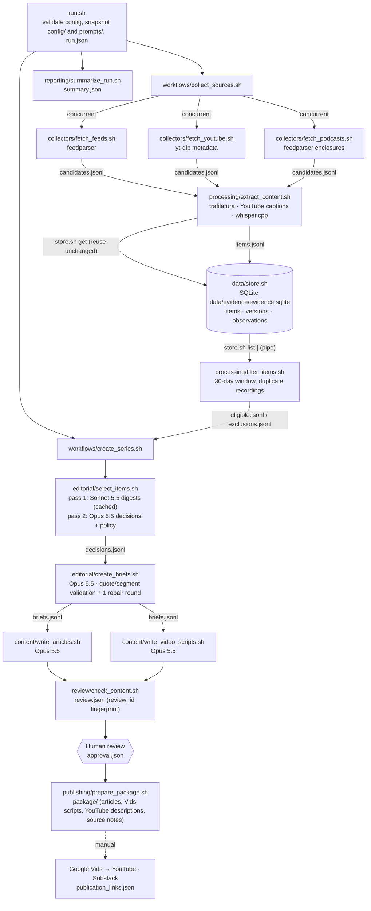

# Problem Set 4 Student Submission

Complete this document with your project details and links. Keep the course instructions in [README.md](README.md) and the required contracts in [ARCHITECTURE.md](ARCHITECTURE.md).

**Student:** TODO  
**GitHub repository:** TODO

## Topic and Audience

- **Publication name:** GUIng Forward. The name is a play on "GUI": the series follows how we interact with computers now that AI sits between us and the interface.
- **Topic:** How AI is changing the way people interact with computers. The series covers four areas:
  - agents that operate software for you (computer-use, browser and desktop agents)
  - assistants built on personal context and new devices (memory, connected apps, smart glasses, wearables)
  - voice and conversational interfaces compared with screens and direct manipulation
  - AI built into operating systems and browsers
- **Audience and assumed knowledge:** Tech enthusiasts and early adopters. They use ChatGPT, Claude or Gemini regularly, know what an LLM and an "agent" are, and follow product launches. They do not read HCI research or vendor documentation, and they cannot tell how well these interfaces work outside the demo.
- **Central question:** *Which new ways of interacting with computers through AI are actually changing how people use them this month, and which are still demos?*
- **Scope and exclusions:**
  - **Included:** launches that change how people operate computers, hands-on reviews and practitioner experience, HCI research with user evidence, and reliability, safety and privacy evidence about these interfaces.
  - **Excluded:** benchmark races, funding and stock news, chips and data centres, policy not tied to an interface, and unsourced rumours.
- **Reason for readers to return:** Each edition re-scores the same question against the last 30 days: what shipped, what held up in real use, and what to watch next. Readers can use it to decide which interfaces are worth adopting.

## Published Series

| Piece | Title | Substack article | YouTube video |
| --- | --- | --- | --- |
| 1 | TODO | TODO | TODO |
| 2 | TODO | TODO | TODO |
| 3 | TODO | TODO | TODO |

**Separate technical demonstration video:** TODO

## Setup and Execution

**Tools used (versions as tested):**
- macOS on Apple Silicon
- Bash 3.2+
- `jq` 1.7
- Python 3.13 with the packages pinned in `requirements.txt`: `anthropic`, `feedparser`, `trafilatura`
- `yt-dlp`
- `ffmpeg`
- `whisper.cpp` (`whisper-cli`) with the `ggml-base.en` model

Install:

```bash
brew install jq yt-dlp ffmpeg whisper-cpp
uv venv .venv.nosync --python 3.13 && uv pip install --python .venv.nosync/bin/python -r requirements.txt
mkdir -p ~/.cache/whisper-cpp && curl -L -o ~/.cache/whisper-cpp/ggml-base.en.bin https://huggingface.co/ggerganov/whisper.cpp/resolve/main/ggml-base.en.bin
cp .env.example .env   # then set ANTHROPIC_API_KEY
```

The `.nosync` suffix keeps the virtualenv out of iCloud sync. `lib/common.sh` looks for an interpreter in this order: `PIPELINE_PYTHON`, then `.venv.nosync`, then `.venv`, then `python3`.

**Credentials and environment variables:** credentials are never written to config snapshots or logs.
- `ANTHROPIC_API_KEY` (required). Read from the environment or from the untracked `.env` file.
- `WHISPER_MODEL` (optional). Path to a whisper.cpp model file.
- `PIPELINE_SIMULATE_FAILURE` (optional). Comma-separated `source_id`s to fail deliberately; every such failure is labelled as simulated.

**Models:** set in `config/project.json` under `pipeline.models`.
- Item digests: `claude-sonnet-5-5`, one call per eligible item, cached per item version.
- Editorial decisions, briefs, articles and video scripts: `claude-opus-5-5`.
- Prices are in `pipeline.pricing_usd_per_mtok`. Every receipt records token usage and the computed cost.

**Configuration:**
- `config/project.json`: topic, audience, central question, voice, themes and pipeline settings.
- `config/sources.json`: 14 sources. Each has `source_id`, `publisher_id`, `kind` and `url`. Optional fields are `name`, `perspective`, `max_items`, `include_keywords` and `min_seconds`.
- `config/editorial_policy.md`: the editorial policy.
- `prompts/*.md`: one prompt file per AI stage.

**Commands:**

```bash
bash run.sh                                   # new live run -> runs/live-YYYYMMDDTHHMMSSZ/, stops at awaiting_review
bash review/record_approval.sh runs/RUN_ID approve "Name" "notes"   # human decision, after reading the drafts
bash run.sh --package runs/RUN_ID             # recheck, verify approval, build runs/RUN_ID/package/
```

Every component can be run on its own, for example to replay a single stage:

```bash
R=runs/RUN_ID
bash collectors/fetch_feeds.sh $R > /tmp/feeds.jsonl
bash processing/extract_content.sh $R < $R/candidates.jsonl > /tmp/items.jsonl
bash data/store.sh list | bash processing/filter_items.sh $R > /tmp/eligible.jsonl
bash data/store.sh get ITEM_ID [VERSION_ID]; bash data/store.sh history ITEM_ID
bash editorial/select_items.sh $R < $R/eligible.jsonl > /tmp/decisions.jsonl
bash editorial/create_briefs.sh $R < $R/decisions.jsonl > /tmp/briefs.jsonl
bash content/write_articles.sh $R < $R/briefs.jsonl > /tmp/articles.jsonl
bash review/check_content.sh $R > /tmp/review.json
bash reporting/summarize_run.sh $R
```

## Architecture and Manual Handoffs



**Where models are called:** only in `editorial/select_items.sh` (both passes), `editorial/create_briefs.sh`, and the two `content/` scripts. They all go through `lib/llm.py`. That file saves the exact request and response under `runs/RUN_ID/llm/<stage>/` and adds token usage and cost to the stage receipt.

**Where evidence is stored:**
- **Evidence index:** `data/evidence/evidence.sqlite`. Only `data/store.sh` opens it, through its helper `data/store_db.py`.
- **Retained text and transcript segments:** `data/assets/text/` and `data/assets/segments/`. Files are content-addressed, so they are never overwritten.
- **Original downloads:** `data/media/`. Podcast and fallback audio are excluded from Git.
- **Item digests:** cached in `data/assets/digests/`.

**Helpers added (each stays inside its owning component's responsibility):**
- `lib/common.sh`: env and interpreter setup, `RUN_DIR` validation, receipts.
- `lib/receipt.py`: writes receipts and computes cost.
- `lib/llm.py`: model provider wrapper.
- `lib/util.py`: hashing, IDs, dates, HTTP.
- `lib/evidence.py`: resolves evidence references through `store.sh get` and renders items for the model.
- Language-specific workers sit next to their components:
  - `collectors/*.py`
  - `processing/extract.py` and `filter.py`
  - `editorial/select.py` and `briefs.py`
  - `content/draft.py`, shared by the article and script components so both use the same evidence passages
  - `review/check.py`
  - `publishing/package.py`
  - `reporting/summarize.py`
- `review/record_approval.sh`: a convenience for the human reviewer only.

**Identity and versioning:**
- **`item_id`:**
  - `feed:<publisher>:<sha256(canonical URL)[:12]>`
  - `youtube:<video id>`
  - `podcast:<publisher>:<sha256(GUID)[:12]>`
- **`version_id`:** sha256 of compact, sorted JSON of `{title, url, published_at, text, segments}`. Retrieval time is excluded. This matches the fixture computation in `examples/`, and the fixture version IDs reproduce exactly.
- **Repeated observations:** the store logs them in `observations`. They never create a version.

**Manual handoffs:**
1. **Human editorial review.** Inputs: `runs/RUN_ID/articles/`, `video_scripts/`, `briefs.jsonl`, `review.json`, `decisions.jsonl`, and the evidence passages. The reviewer records corrections in `runs/RUN_ID/corrections.md` and writes `approval.json` with `review/record_approval.sh`.
2. **Packaging.** `bash run.sh --package runs/RUN_ID` produces `package/`.
3. **Google Vids.** Input: `package/video_scripts/NN.md` (narration without claim markers; on-screen source lines) via "docs to video". Output: a rendered 3–5 minute MP4.
4. **YouTube.** Upload with `package/youtube/NN_description.txt`.
5. **Substack.** Publish `package/articles/NN.md`. Claim markers have become numbered sources, the AI disclosure is appended, and access is free.
6. **Links.** Record the URLs in `package/publication_links.json` and repackage. Links are preserved and placeholders are filled.

## Evidence and Runs

TODO

## Editorial Review

TODO

## Reflection

TODO
